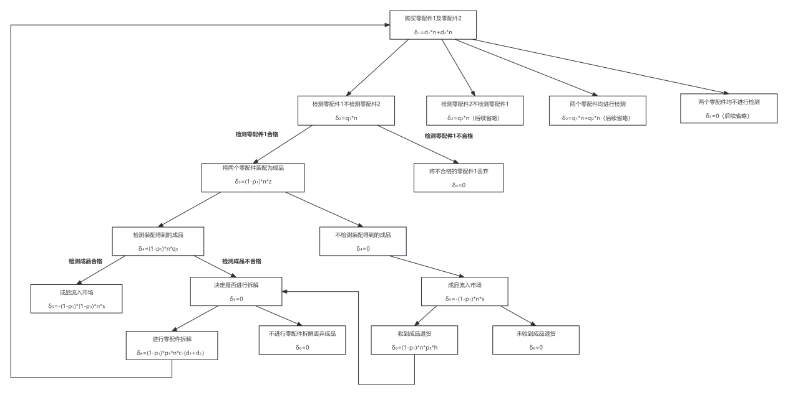
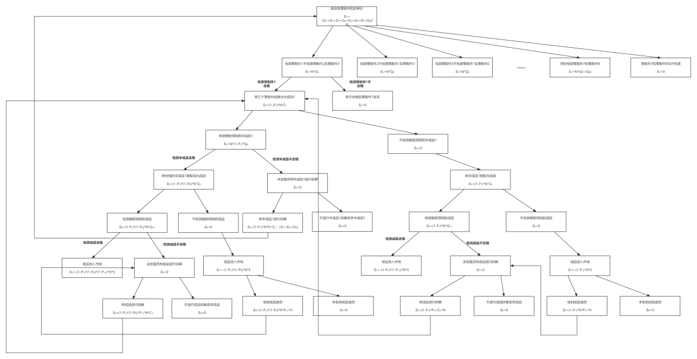

# Production Decision Modeling: Decision Trees & Bayesian Updating
**English | [中文](./README.zh.md)**

A mathematical modelling project from the **2024 China Undergraduate Mathematical Contest in Modeling (CUMCM) (Shanghai Region, Third Prize)**. The project addresses multi-stage production decision-making for consumer electronics, balancing inspection costs and quality control.

## Project Overview
The study models the production process from parts procurement to final assembly, aiming to find the minimum loss path under various defect rates and inspection strategies. It combines four core components:

1. **Sampling Size Optimization:** Derived minimum sample sizes under different confidence levels using normal approximation and the Central Limit Theorem (CLT).
2. **Basic Decision Tree:** Modeled the costs and benefits of parts inspection, assembly, and dismantling to find the minimum-loss path.
3. **Extended Decision Tree:** Expanded the model to 2 production stages and 8 parts, evaluating 20 different inspection schemes simultaneously.
4. **Bayesian Updating:** Introduced a Beta-Binomial model to dynamically update the defect rate estimates based on inspection data.

## Key Contributions & Findings
- **Sampling Strategy:** Calculated that under a 95% confidence level, the optimal sample size is 125 (reducing to 76 for 90% confidence), effectively balancing inspection cost and accuracy.
- **Cost Minimization:** Demonstrated that skipping parts and final product inspections but using a replacement strategy for defective products can yield the minimum total loss.
- **Dynamic Inference:** Showed how Bayesian inference improves the accuracy of defect rate estimation in real-time, optimizing subsequent production decisions.

## 📊 Decision Tree Structures

**1. Basic Decision Tree (Stage 1)**

*Node-by-node loss evaluation for parts inspection, assembly, and dismantling paths.*

**2. Extended Decision Tree (Multi-stage & Multi-part)**

*Complex decision paths for 2 production stages and 8 parts, evaluating 20 different inspection schemes.*

## 💻 Code Implementation
The repository contains the core algorithmic implementations to calculate the minimum-loss paths:
- [`decision_tree_model.py`](./decision_tree_model.py): Iterates through all possible production strategies (parts inspection, product inspection, replacement, and dismantling) to calculate expected losses and find the optimal strategy.
- [`extended_decision_tree_model.py`](./extended_decision_tree_model.py): Evaluates complex inspection schemes across multiple stages and parts to determine the minimum-loss path.

## 🛠️ Tools
- **Methods:** Decision Trees, Central Limit Theorem (Normal Approximation), Bayesian Inference (Beta-Binomial Model)
- **Tools:** Python
