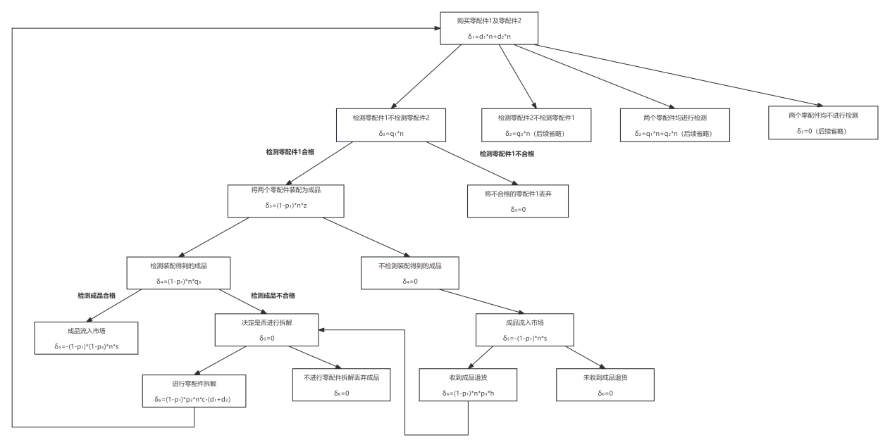
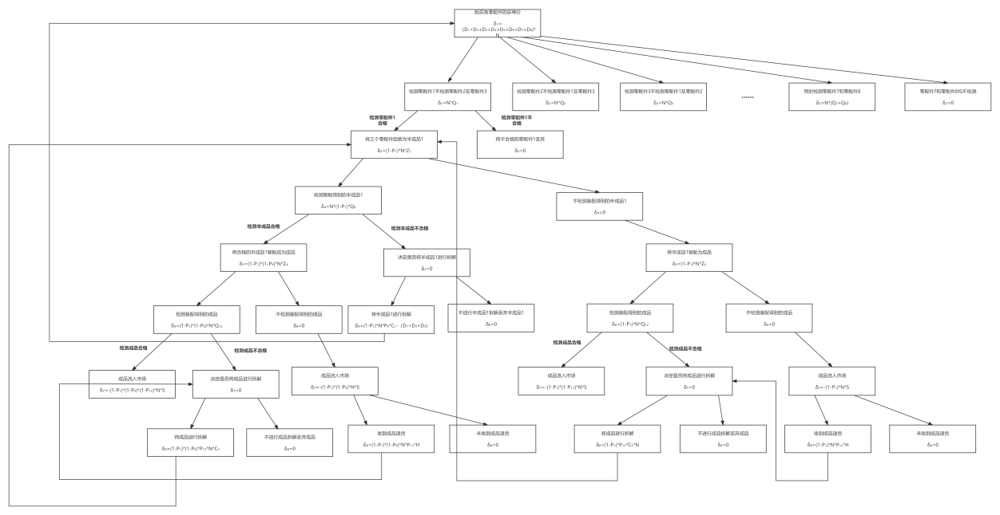

# 电子产品生产决策建模：决策树与贝叶斯更新
**[English](./README.md) | 中文**

本项目为 **2024年全国大学生数学建模竞赛（上海赛区三等奖）** 的参赛项目。项目针对电子产品生产过程中的多阶段决策问题，在检测成本与质量控制之间寻求最优平衡。

## 项目概述
本研究对从零配件采购到成品装配的生产过程进行了数学建模，旨在寻找在不同次品率和检测策略下的最小损耗路径。模型包含四个核心部分：

1. **抽样样本量优化**：基于正态分布近似模型和中心极限定理（CLT），推导了不同置信度下的最小抽样次数。
2. **基础决策树**：构建了零配件检测、成品装配与拆解的决策树，计算各路径成本与收益，寻找最小损耗路径。
3. **扩展决策树**：将模型扩展至 2 道工序和 8 个零配件的情境，综合评估了 20 种不同检测方案。
4. **贝叶斯动态更新**：引入 Beta-Binomial 模型，结合抽样检测数据，动态更新次品率估计。

## 核心结论与贡献
- **抽样策略**：计算得出在 95% 信度下最小样本量为 125 次（90% 信度下为 76 次），帮助企业有效平衡了检测成本与精度。
- **成本最小化**：证明在特定情况下，跳过零配件和成品检测，直接销售并采用换货策略处理不合格品，能够实现最小总损耗。
- **动态推断**：展示了贝叶斯推断如何通过实时数据提升次品率估计的准确性，从而优化后续生产决策。

## 📊 决策树结构图

**1. 基础决策树（单阶段）**

*针对零配件检测、装配和拆解路径的逐节点损耗评估。*

**2. 扩展决策树（多工序与多零件）**

*针对 2 道工序和 8 个零配件的复杂决策路径，综合评估了 20 种不同检测方案。*

## 💻 代码实现
本仓库包含了用于计算最小损耗路径的核心算法实现：
- [`decision_tree_model.py`](./decision_tree_model.py)：遍历所有可能的生产策略（零配件检测、成品检测、调换、拆解等），计算预期损耗并寻找最优策略。
- [`extended_decision_tree_model.py`](./extended_decision_tree_model.py)：在多阶段和多零配件的复杂环境中，评估不同的检测方案以确定最小损耗路径。

## 🛠️ 方法与工具
- **方法**：决策树 (Decision Trees)、中心极限定理/正态近似 (CLT/Normal Approximation)、贝叶斯推断/Beta-Binomial 模型
- **工具**：Python
